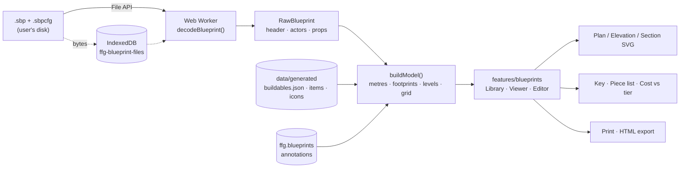
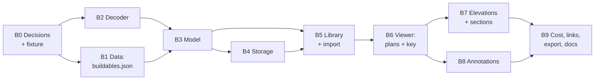

# Blueprint Schematics: delivery plan

> Import a Satisfactory blueprint (`.sbp` with its `.sbpcfg`) and read it as a floor-by-floor build schematic inside the Field Guide. Each floor gets a to-scale plan; the set also has elevations, cut sections, a callout key, a piece list and the blueprint's item cost checked against your tier. Decoding happens entirely in the browser, offline.

- **Owner:** Nick
- **Status:** Proposed, awaiting decisions D1–D4 (§3)
- **Last updated:** 2026-11-10
- **Proof of concept:** the `satisfactory-blueprint-schematic` skill in `solstice035/personal-skills` (PR #1). It is a Python decoder and HTML renderer, validated on _Pioneer Outpost [PO-1]_ (833 pieces, Mk.3 designer). This plan ports that into the app as TypeScript.

---

## 1. Why, and how it fits the product

The guide already tells a pioneer to "blueprint your manifold modules" at Tier 4 (`t4-blueprints`) and Tier 6 (`t6-blueprints-mk2`). Community blueprints are opaque until you place them: you can't see what is inside, what it costs, or how to walk around it. This feature answers three questions for a blueprint file on your disk:

1. **What is in it, floor by floor?** Plans, elevations and sections, plus a key to every machine, switch and labelled sign.
2. **Can I afford it now?** Its item cost, with icons, set against your current tier and the tier when each item becomes producible.
3. **How do I get around it and run it?** Stairs, ladders and lifts; what each power switch controls; and where belts come in and go.

It keeps to the product principles (`PRODUCT.md`):

| Principle                | How this feature honours it                                                                     |
| ------------------------ | ----------------------------------------------------------------------------------------------- |
| Next action first        | The overview opens with the build cost against your tier and how to get in and up the structure |
| Numbers are the product  | Positions, heights, lengths and belt routes are decoded from the file, never estimated          |
| Rooted in place          | Grid references (`C9`) and heights are the same on every floor, so you can find things in-game  |
| Honest about uncertainty | Approximate footprints and relative north are labelled on every sheet                           |
| Yours, offline           | Files are read locally; nothing is uploaded and nothing ships with the app                      |

### Reversing a previous "Won't"

`docs/BACKLOG_REVIEW.md` (2026-10-11) scored **#13 Blueprint integration** as ⛔ _Won't_, alongside "blueprint libraries", because they conflict with the local-first, no-network charter. This plan is narrower than what that review rejected:

- **In scope:** opening a `.sbp` file the user already has and showing it in the app, offline.
- **Still out:** browsing, downloading or sharing blueprint libraries, any network call, and writing or editing `.sbp` files.

Decision **D1** confirms the reversal, and its outcome gets recorded in `BACKLOG_REVIEW.md` and `PLAN.md` §14.

## 2. Outcomes

| #   | Outcome                        | Measure of done                                                                                                                                                                                                                                           |
| --- | ------------------------------ | --------------------------------------------------------------------------------------------------------------------------------------------------------------------------------------------------------------------------------------------------------- |
| B1  | **Import** a blueprint offline | Drag-and-drop or file picker for `.sbp` (+ optional `.sbpcfg`). Decodes in a Web Worker in under 500 ms for an 800-piece Mk.3 blueprint on a mid-range laptop, with no network requests                                                                   |
| B2  | **Floor-by-floor plans**       | Floors are detected automatically and can be adjusted. Each floor's to-scale SVG plan shows slabs, catwalks, stairs (with up-arrow and heights), walls by type, doors and gates, fences, belts with flow arrows, power lines, beams and numbered callouts |
| B3  | **Elevations and sections**    | Four elevations with level datums, plus 2–3 cut sections. The section cuts can be set on the plan                                                                                                                                                         |
| B4  | **Key and piece list**         | A callout table per floor (item, grid reference, heights, switch labels, sign text, lift ranges). Per-floor and total piece counts, using game names and icons                                                                                            |
| B5  | **Cost against tier**          | The header item cost, with icons, shows the tier each item becomes producible and whether it's affordable at the current guide tier                                                                                                                       |
| B6  | **Annotate and keep**          | Rename floors, move band edges, write floor notes and place section cuts. These persist across reloads and are included in backups                                                                                                                        |
| B7  | **Export**                     | A print stylesheet plus a self-contained HTML export of the schematic set, equivalent to the skill's output                                                                                                                                               |
| B8  | **Engineering quality**        | Repo "done" passes (lint, typecheck, tests, build). `src/lib/blueprint` has ≥ 95 % line coverage, axe finds zero violations on the new routes, and the design passes the DESIGN.md rules                                                                  |

## 3. Decisions needed (Nick)

| #   | Decision                                        | Options                                                                                                                                                  | Recommendation                                                                                                                                                                                                                        |
| --- | ----------------------------------------------- | -------------------------------------------------------------------------------------------------------------------------------------------------------- | ------------------------------------------------------------------------------------------------------------------------------------------------------------------------------------------------------------------------------------- |
| D1  | Reverse the "Won't" for local blueprint import? | Yes, as scoped in §1 / No                                                                                                                                | **Yes**. It reads local files only, with no libraries and no network                                                                                                                                                                  |
| D2  | Where do imported files live?                   | (a) IndexedDB for file bytes, `localStorage` for annotations · (b) annotations only, so the file is re-imported each session · (c) all in `localStorage` | **(a)**. The PO-1 file is 80 KB, so ten blueprints would put real pressure on the ~5 MB `localStorage` budget that progress also uses                                                                                                 |
| D3  | Test fixture                                    | (a) Nick builds a small purpose-made blueprint in-game and commits it · (b) ask Telehope for permission to commit PO-1 · (c) synthetic files only        | **(a) + (c)**. A 20–40-piece fixture covering every feature (foundation stack, walls, door, catwalk, stairs, belt, lift, splitter, power line, switch, sign, beam), plus synthetic encoder tests. PO-1 stays a local-only golden test |
| D4  | Footprint source for non-production buildables  | (a) extend `data:build` from the Docs, with a hand-entered override table for gaps · (b) hand-entered table only                                         | **(a)**. It matches the existing pipeline, and the overrides get tests and are labelled "approximate" in the UI                                                                                                                       |

## 4. Assumptions (stated, not asked)

1. **Formats:** `.sbp` header versions as of build 517554 (save version 60, Update 1.1/1.2). The decoder rejects unknown header versions with a clear message rather than guessing.
2. **Designer sizes:** Mk.1 4×4×4, Mk.2 5×5×5 and Mk.3 6×6×6 cells of 8 m. Blueprints top out at a few thousand actors, so everything can be done in memory.
3. **North is relative.** It is drawn as the blueprint's −Y, matching the app's convention (x east, y south). The game lets you rotate blueprints on placement, so every sheet says so.
4. **Units:** decoded centimetres are converted to metres at the model boundary; the app uses metres throughout (CLAUDE.md).
5. **Text:** the UI quotes sign text verbatim. Placeholder text ("Set Text Here…") and icon-only signs are treated as having no text.
6. **No new runtime dependencies.** zlib decompression uses the platform `DecompressionStream('deflate')`, which is available in modern browsers and Node 22 (Vitest). SVG is hand-rolled, as in `FloorPlanView`.

## 5. Architecture



### Modules

| Path                                 | Responsibility                                                                                                                                                                                     | Purity               |
| ------------------------------------ | -------------------------------------------------------------------------------------------------------------------------------------------------------------------------------------------------- | -------------------- |
| `src/lib/blueprint/reader.ts`        | `ByteReader` (i32/u32/i64/f32/f64, FString incl. UTF-16) over `DataView`                                                                                                                           | pure                 |
| `src/lib/blueprint/decode.ts`        | Header (versions, dims, cost, recipes), skip the version block to the first chunk tag, inflate chunks, actor/component headers, data section → `RawBlueprint`                                      | pure (async inflate) |
| `src/lib/blueprint/props.ts`         | Targeted property extractors: `mLength`, spline `Location`s, `CachedRelativeLocations`, `mTopTransform`, ports, sign/switch text filter                                                            | pure                 |
| `src/lib/blueprint/sbpcfg.ts`        | Description, icon id and colour from `.sbpcfg` for library cards                                                                                                                                   | pure                 |
| `src/lib/blueprint/geometry.ts`      | Quaternion maths, yaw, pivot conventions, oriented footprints, z-extent per piece                                                                                                                  | pure                 |
| `src/lib/blueprint/levels.ts`        | Walking-surface detection, automatic bands, reference-z rule, applying user band edges                                                                                                             | pure                 |
| `src/lib/blueprint/grid.ts`          | Grid extent and `gridRef(x, y)` (columns 1…n west→east, rows A…n north→south, 4 m cells)                                                                                                           | pure                 |
| `src/lib/blueprint/model.ts`         | `buildModel(raw, gameData, annotations)` → `BlueprintModel` (pieces with names, categories, levels, callouts, flows, BOM, cost-vs-tier)                                                            | pure                 |
| `src/lib/blueprint/project.ts`       | Elevation/section projection: depth sort, cut-band filter, datum list                                                                                                                              | pure                 |
| `src/lib/blueprint/callouts.ts`      | Choosing callouts (key items, text signs, grouping repeats) and placing bubbles with leader lines without overlap                                                                                  | pure                 |
| `src/lib/blueprint/worker.ts`        | Thin Web Worker wrapper around `decodeBlueprint` (Vite `?worker`)                                                                                                                                  | —                    |
| `src/state/blueprints.ts`            | Zustand + `persist` (`ffg.blueprints` v1): library index and per-blueprint annotations                                                                                                             | store                |
| `src/state/blueprintFiles.ts`        | IndexedDB file store with an in-memory fallback and a status signal, mirroring `createResilientStorage`                                                                                            | store                |
| `src/features/blueprints/*`          | `BlueprintsPage` (library + import), `BlueprintViewer` (floor tabs, sheets), `PlanSheet`, `ElevationSheet`, `SectionSheet`, `KeyTable`, `PieceList`, `CostPanel`, `AnnotationsPanel`, `exportHtml` | UI                   |
| `scripts/data/*`                     | Emit `buildables.json`: every `Build_*` with name, category and footprint (from the Docs where present)                                                                                            | pipeline             |
| `src/content/blueprintFootprints.ts` | Hand-entered footprints and pivots for buildables the Docs don't size (sink, MAM, containers…), marked approximate                                                                                 | content              |

Dependency direction stays `features → state, lib/blueprint → data`. `lib/blueprint` imports no React and no store.

### Domain types (sketch)

```ts
interface RawBlueprint {
  header: {
    headerVersion: number;
    saveVersion: number;
    buildVersion: number;
    dims: [number, number, number];
    cost: { item: string; amount: number }[];
    recipes: string[];
  };
  actors: RawActor[]; // components dropped after linking ports
}
interface RawActor {
  classId: string; // 'Build_Foundation_Metal_8x1_C'
  rotation: Quat;
  position: Vec3; // centimetres, as decoded
  props: {
    length?: number;
    spline?: Vec3[];
    wireEnds?: [Vec3, Vec3];
    liftDz?: number;
    text?: string;
    ports?: string[];
  };
}
interface BlueprintModel {
  pieces: Piece[]; // metres; category, footprint polygon, z0/z1, levelId, gridRef
  levels: Level[]; // id, name, label, zMin, zMax, auto|user
  callouts: Record<string, Callout[]>;
  belts: Flow[];
  lifts: Flow[];
  wires: Segment[];
  cost: CostLine[]; // item, amount, producibleFromTier, affordableNow
  grid: { half: number; cells: number };
}
interface BlueprintAnnotations {
  // persisted
  levels?: {
    id: string;
    name: string;
    zMin: number | null;
    zMax: number | null;
    notes: string[];
  }[];
  sections?: { name: string; view: 'S' | 'N' | 'E' | 'W'; at: number; half: number }[];
  textFixes?: Record<string, string>;
}
```

### Placement conventions (from the proof of concept)

Each of these becomes a named unit test:

- **Foundations** (concrete, metal, frame, glass), inverted frame ramps, quarter pipes and lift floor holes pivot at their vertical centre.
- **Walls** pivot at bottom-centre and run 8 m along local Y. **Fences and railings** run 4 m along local Y. **Signs** take their width along local X.
- **Catwalks** pivot at the walking surface. **Catwalk stairs** are 4×4×4 m, pivot at the bottom, and climb toward +X at yaw 0.
- **Belt splines and power-line ends** are actor-local; world = position + rotate(quat, p).
- **Lift** height = `mTopTransform.Translation.z`, which can be negative.
- **Reference z for banding:** slab top for solid slabs, centre for frame structure, base for everything else.

## 6. UX

- **Routes:** `/blueprints` (library) · `/blueprints/:id` (overview) · `/blueprints/:id/floor/:levelId` · `/blueprints/:id/elevations` · `/blueprints/:id/sections`. Every view can be deep-linked; floor tabs follow the WAI-ARIA tabs pattern via `useRovingTabs`.
- **Nav:** a "Blueprints" entry in the shell. Tier 4 and Tier 6 blueprint steps link to the library ("Open a blueprint").
- **Library:** a labelled drop zone, plus a file input for keyboard and touch users. Cards show the name, `.sbpcfg` description, designer size, piece count, floor count and a cost summary. Delete has an undo receipt (as in I-87), and there's a rename option.
- **Viewer layout:**

  ```mermaid
  flowchart TB
    H["Header: name · designer · pieces · height · ⚠ approximate footprints, relative north"]
    C["Cost vs tier panel (icons + names, 'producible from Tier N', affordable ✓/✗ with text)"]
    T["Floor tabs: G · L1 · L2 · L3 · … · Elevations · Sections"]
    S["Sheet: SVG plan in its own scroll container · legend disclosure"]
    K["Key table · Floor notes (editable) · Piece list (disclosure)"]
    H --> C --> T --> S --> K
  ```

- **Design (DESIGN.md):** dark graphite panel and theme tokens only (`var(--color-*)`, no new hex literals). Amber is reserved for the selected floor tab and the current callout. Callout bubbles and wall types use text or glyph as well as colour (D/G door markers, legend text). Diagrams have text alternatives, and the key table carries the same information as the drawing.
- **Interaction:** hovering or focusing a key-table row highlights its callout and the reverse. Section cuts can be set from a numeric field (the non-drag alternative required by WCAG 2.2) and optionally by dragging on the plan. Plans scroll and zoom inside their own container at 360 px.
- **Glance:** out of scope for v1. A "current floor" glance card is backlog.

## 7. Testing strategy

| Layer             | What                                                                                                                                                                                                                                                      | Tooling                             |
| ----------------- | --------------------------------------------------------------------------------------------------------------------------------------------------------------------------------------------------------------------------------------------------------- | ----------------------------------- |
| Unit (test-first) | Reader primitives incl. UTF-16 strings; chunk inflate; header/actor/component parsing; property extractors; quaternion/yaw; every placement convention; auto-banding; `gridRef`; callout de-overlap; projection and cut filter; cost-vs-tier              | Vitest                              |
| Synthetic files   | `__fixtures__/encodeSbp.ts` writes valid `.sbp` bytes from a spec (header, chunks via `node:zlib`, actors and properties). Round-trip tests cover every class of extra, plus malformed input (bad tag, truncated chunk, unknown version → readable error) | Vitest                              |
| Fixture blueprint | Nick's purpose-made blueprint (D3): exact piece counts, floors, grid refs, belt and lift ranges and sign text asserted                                                                                                                                    | Vitest                              |
| Golden (local)    | PO-1 and any other `.sbp` placed in `data/raw/blueprints/` (git-ignored). Parity with the skill's Python decoder: counts, transforms, lengths, lift heights and text. Skipped when absent, so CI is unaffected                                            | Vitest + `npm run blueprint:verify` |
| Data integrity    | Every `Build_*` class seen in fixtures resolves in `buildables.json` or the overrides. Footprint overrides have sane dimensions                                                                                                                           | Vitest                              |
| Component         | Import flow (drop and picker), floor-tab keyboard nav, annotations persist across reloads, key ↔ callout highlight, undo delete                                                                                                                           | RTL + user-event                    |
| Accessibility     | Zero axe violations (`wcag22aa`) on library, overview, floor and sections                                                                                                                                                                                 | axe-core                            |
| Browser           | Smoke at 1440 px and 390 px with screenshots of every sheet for the fixture and PO-1, and a decode performance check against B1                                                                                                                           | Playwright (dev only)               |

CI adds `src/lib/blueprint` to the ≥ 95 % line-coverage floor that `src/lib/calc` already has.

## 8. Delivery phases

Each phase is one PR from a `feature/*` branch into `main`. Issue IDs are filled in once the phases are entered in Linear (project _FICSIT Field Guide_).



| Phase                        | Scope                                                                                                                                                                                    | Acceptance                                                                                                                    |
| ---------------------------- | ---------------------------------------------------------------------------------------------------------------------------------------------------------------------------------------- | ----------------------------------------------------------------------------------------------------------------------------- |
| **B0 Decisions & fixture**   | Record D1–D4. Nick exports the fixture blueprint. Add `data/raw/blueprints/` to `.gitignore`. Update `BACKLOG_REVIEW.md` #13 and `PLAN.md` §14                                           | Decisions written down; fixture committed under `src/lib/blueprint/__fixtures__/`                                             |
| **B1 Data: buildables**      | `data:build` emits `buildables.json` (all `Build_*`: name, category, footprint where the Docs have one); `blueprintFootprints.ts` overrides with an `approximate` flag; typed accessors  | Every class in the fixture and PO-1 resolves; data-integrity test green; `DATA.md` updated                                    |
| **B2 Decoder**               | `reader`, `decode`, `props`, `sbpcfg`, worker wrapper; synthetic encoder; error messages                                                                                                 | Fixture and PO-1 (local) decode with parity to the Python skill; malformed files give a readable error; ≥ 95 % coverage       |
| **B3 Model**                 | `geometry`, `levels`, `grid`, `model`, `callouts`, `project`; cost-vs-tier via `data/availability`                                                                                       | Auto levels for PO-1 match the skill's bands to within one band; grid refs match the published PO-1 schematic                 |
| **B4 Storage**               | `blueprintFiles` (IndexedDB + fallback + status), `blueprints` store v1, backup v3 (annotations always, file bytes optional), migration test                                             | Reload keeps library and annotations; blocked IndexedDB falls back with the existing storage notice; v2 backups still restore |
| **B5 Library & import**      | Route, nav entry, drop zone + picker, worker decode with progress, cards, rename, delete + undo                                                                                          | Import → card in < 500 ms (B1); axe clean; keyboard-only import works                                                         |
| **B6 Viewer: plans & key**   | Floor tabs, `PlanSheet` (port of the skill's plan renderer onto theme tokens), legend, key table with two-way highlight, piece list                                                      | Every floor of the fixture and PO-1 renders; screenshots reviewed at 1440/390; tables mirror the drawings                     |
| **B7 Elevations & sections** | `ElevationSheet` ×4 with datums, `SectionSheet` with cut bands, cut lines on the chosen plan                                                                                             | Sections show only the cut band; datums match the level edges                                                                 |
| **B8 Annotations**           | Edit floor names, band edges (NumberField), notes, section cuts (numeric + optional drag), text fixes                                                                                    | Edits re-band the model live and persist; undo for destructive edits                                                          |
| **B9 Integration & export**  | Cost panel with icons and tier; Tier 4/6 step links; print stylesheet; standalone HTML export (`renderToStaticMarkup` + inlined CSS); docs (README, ARCHITECTURE, PLAN §14), screenshots | Export opens offline and matches the in-app sheets; repo "done" green; README screenshot added                                |

**Indicative sizing:** B2 and B6 are the largest phases (about two sessions each). B0, B1, B4 and B8 are small, and the rest are medium.

## 9. Risks and mitigations

| Risk                                                           | Mitigation                                                                                                                                                          |
| -------------------------------------------------------------- | ------------------------------------------------------------------------------------------------------------------------------------------------------------------- |
| Format changes in future patches (new header blocks, versions) | Skip to the first chunk tag, as the PoC already does; check header and save versions explicitly; add a fixture per new version; the error message names the version |
| Targeted property scanning misreads an unusual property        | Extractors match the property name and struct path, never bare bytes; parity tests against the Python decoder; unknown props are ignored, not guessed               |
| Approximate footprints for non-production buildables           | Labelled "approximate" on every sheet; centres and orientation are exact; overrides are tested and easy to correct                                                  |
| Copyright of third-party blueprints                            | Never bundled or uploaded; files stay on the user's machine; tests use Nick's own fixture (D3)                                                                      |
| `localStorage` quota pressure                                  | File bytes in IndexedDB (D2); annotations are small; the existing resilient-storage notice covers failures                                                          |
| Large or dense blueprints hurt SVG performance                 | Bounded by Mk.3 size; memoise per-floor SVG; skip off-band pieces; measure in B6 and paginate the piece list if needed                                              |
| Scope creep toward a 3D viewer or library sharing              | Explicitly out (§10); revisit only through the backlog                                                                                                              |

## 10. Out of scope (this plan)

Writing or editing `.sbp` files; 3D or isometric views; browsing, downloading or sharing blueprint libraries; matching blueprints to save files (that belongs to I-72); placing blueprints on the world map; a `/glance` card. Any of these can be proposed later through Linear.

## 11. Definition of done

`npm run format:check && npm run lint && npm run typecheck && npm run coverage && npm run build` all pass. Outcomes B1–B8 are met. Screenshots of every PO-1 and fixture sheet have been reviewed at 1440 px and 390 px. Docs are updated (README features and screenshot, ARCHITECTURE modules, DATA `buildables.json`, PLAN §14), and the BACKLOG_REVIEW #13 decision is recorded.
